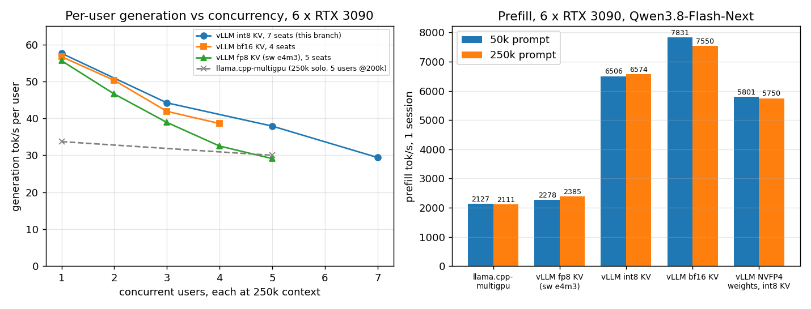

# vllm-ampere-multigpu

### Qwen3.8-Flash-Next (125B-A6B) served by vLLM on six 24 GB consumer GPUs: 7 users at 262k context, 6.5k tok/s prefill, 57 tok/s generation

Upstream vLLM refuses to run this model with pipeline parallelism, needs a 102 GB table pinned in host RAM, and its
fp8 KV cache crashes on Ampere. This branch is upstream vLLM (nightly `7d0b4e57a`, 2026-10-09) plus a small set of
Python-only fixes that make the model run on machines like a 6 × RTX 3090 box with 187 GB RAM. Measured
2026-10-11/12 on that machine (AMD 7950X, four of the six cards behind Thunderbolt, no NVLink for most pairs),
GPTQ-INT4 checkpoint, one streaming request per cell unless stated:

| workload | context | llama.cpp-multigpu (same box) | **this branch, int8 KV** | this branch, bf16 KV |
| --- | --- | ---: | ---: | ---: |
| prefill, 1 session | 50k | 2,127 t/s | **6,506 t/s** | 7,831 t/s |
| prefill, 1 session | 250k | 2,111 t/s | **6,574 t/s** | 7,550 t/s |
| time to first token, 250k prompt | 250k | 118 s | **37.8 s** | 33 s |
| generation, 1 session | 250k | 33.7 t/s | **57.6 t/s** | 56.7 t/s |
| generation, 3 sessions (per session / sum) | 250k | – | **44.2 / 133 t/s** | 41.9 / 126 t/s |
| generation, 5 sessions (per session / sum) | 250k | 30 / 150 t/s (at 200k) | **37.9 / 190 t/s** | does not fit |
| generation, 7 sessions (per session / sum) | 250k | does not fit (5 slots) | **29.4 / 206 t/s** | does not fit |
| 262k contexts resident in GPU KV | | 5 | **7.33** | 4.03 |
| host RAM available with the server idle | | 154 GiB | **141 GiB** | 142 GiB |
| needle-in-haystack 50k / 200k | | pass / pass | **pass / pass** | pass / pass |



The llama.cpp column is [llama.cpp-multigpu](https://github.com/lukolszewski/llama.cpp-multigpu), the patched
llama.cpp that runs the same model on the same machine; stock llama.cpp is 4-10x slower than that again. Stock vLLM
has no column because it does not start: the model's pipeline-parallel guard refuses `--pipeline-parallel-size > 1`,
and a 24 GB card cannot hold the model at TP=1 (TP must be 1, 2, 4 or 8, so six cards cannot be used with TP either).

Full tables, the fp8 and NVFP4 experiments, the host-RAM KV tier test and the raw JSON: [docs/ampere-multigpu/benchmarks.md](docs/ampere-multigpu/benchmarks.md).
What each change does, with file names: [docs/ampere-multigpu/patches.md](docs/ampere-multigpu/patches.md).
How to run it: [§3](#3-usage). Where it does not help: [§5](#5-known-limitations).

**Status: a fixing branch, not a project.** This is upstream vLLM with 16 files touched (1,742 lines, Python only, no
new kernels outside the model's own Triton ops). It exists so that people with the same kind of hardware can run this
model today; the intended end state is that the fixes land upstream and this branch is deleted. Everything else about
vLLM is unchanged: same image, same `vllm serve`, same OpenAI API, same options.

| | |
| --- | --- |
| Upstream | [vllm-project/vllm](https://github.com/vllm-project/vllm) (Apache-2.0), the project this branch tracks |
| This branch | [`ampere-multigpu`](../../tree/ampere-multigpu): upstream `7d0b4e57a` + the fixes below, the only branch meant for use |
| Base image | `vllm/vllm-openai:cu129-nightly-7d0b4e57aac4c4323225b0eee9ae960ce75ffffe` (the changed files are bind-mounted over it, see §3) |
| Upstream README | [README-upstream.md](README-upstream.md) |

## 1. What the branch changes

Six things, all for the Qwen4Exp model family (Qwen3.8-Flash-Next) on NVIDIA GPUs; details and file names in
[patches.md](docs/ampere-multigpu/patches.md):

1. **Pipeline parallelism is allowed.** The model's config verifier and both `model_state` modules rejected PP outright.
   They now require `VLLM_PP_LAYER_PARTITION` and check that the n-gram (PLE) layer stays on stage 0, the only rank that
   sees raw input ids. A KV-cache allocation bug that killed every non-first rank under PP is fixed with it.
2. **GPTQ checkpoints load.** gptqmodel checkpoints quantize only the Linear layers; the PLE table and the indexer
   projection stay bf16, which the loader did not expect (needed at PP=1 too).
3. **The 102 GB PLE table stays on SSD.** Port of upstream PR [#58815](https://github.com/vllm-project/vllm/pull/58815)
   by Trosfy (`--engram-config '{"host_file_gather": true}'`): rows are read from the safetensors shards each step and
   cached by the page cache instead of being pinned in host RAM. Host RAM available with the server idle went from
   15 GiB to 141 GiB on the test box, load time from ~400 s to 240 s, speed unchanged (measured).
4. **int8 KV cache for the sparse-attention (QSA) kernels.** vLLM's `--kv-cache-dtype int8_per_token_head` (int8 plus one
   fp32 scale per token and head) is implemented in the fused prepare and sparse paged attention kernels. 1.8x the KV
   capacity of bf16 at 83-87 % of its prefill speed and equal generation speed; 7 x 262k contexts on six 24 GB cards.
5. **fp8 KV cache works on Ampere** (sm < 89 has no e4m3 conversion in Triton; it is done in software). Kept for
   completeness and for 2.1x KV capacity, but prefill is 3.3x slower, so int8 is the recommended compact mode.
6. **Host-RAM KV tier verified** with vLLM's own `--kv-offloading-size`: a 230k-token context evicted from the GPUs comes
   back in ~3 s instead of a 43 s re-prefill (no code change, included because the combination with int8 KV and PP was
   unproven).

## 2. Hardware tested

| machine | GPUs | host | interconnect | notes |
| --- | --- | --- | --- | --- |
| machine-01 | 6 × RTX 3090 24 GB (sm_86) | AMD 7950X, 187 GB DDR5, PCIe 4 NVMe | GPU0/1 PCIe 4 x8 + NVLink, GPU2-5 behind Thunderbolt (~1 GB/s under load) | all numbers above |
| dev | 1 × RTX 5060 Ti 16 GB (sm_120) | same box | | kernel unit tests only (int8 and e4m3 paths bit-exact against oracles) |

PP=6 with one stage per card is the only layout that fits: the model is 125B parameters (GPTQ-INT4 body 85 GB, PLE
table 102 GB bf16 served from disk). Each card holds eight layers plus its share of the KV cache. The slow interconnect
is survivable because pipeline parallelism moves one activation tensor per layer boundary per step, not weights.

## 3. Usage

Checkpoint: [btbtyler09/Qwen3.8-Flash-Next-GPTQ-4bit](https://huggingface.co/btbtyler09/Qwen3.8-Flash-Next-GPTQ-4bit)
(the NVFP4 checkpoints also load but are slower on Ampere, see benchmarks.md). The branch is Python-only, so the
simplest deployment is the stock nightly image with the changed files mounted over it:

```bash
# files this branch changes relative to upstream 7d0b4e57a (16 files; the two under tests/ are optional)
git diff 7d0b4e57a --name-only -- vllm/
# that nightly image ships a torchcodec that links a missing libnvrtc.so.13 and breaks `vllm serve` at import:
printf 'FROM vllm/vllm-openai:cu129-nightly-7d0b4e57aac4c4323225b0eee9ae960ce75ffffe\nRUN pip uninstall -y torchcodec\n' | docker build -t vllm-ampere:7d0b4e57a -
```

Mount every changed file at `/usr/local/lib/python3.12/dist-packages/vllm/<same path>` (`-v $PWD/vllm/x.py:/usr/local/lib/python3.12/dist-packages/vllm/x.py:ro`,
docker creates mount points for files the image lacks) and run:

```bash
VLLM_PP_LAYER_PARTITION=8,8,8,8,8,8 \
vllm serve /models/Qwen3.8-Flash-Next-GPTQ-4bit \
  --served-model-name qwen3.8-flash-next --dtype bfloat16 \
  --pipeline-parallel-size 6 --tensor-parallel-size 1 --distributed-executor-backend mp \
  --max-model-len 262144 --max-num-seqs 7 --gpu-memory-utilization 0.92 \
  --kv-cache-dtype int8_per_token_head \
  --engram-config '{"host_file_gather": true}' \
  --kv-offloading-size 36 --kv-offloading-backend native \
  --reasoning-parser qwen3 --enable-auto-tool-choice --tool-call-parser qwen3_xml \
  --trust-remote-code
```

- `VLLM_PP_LAYER_PARTITION` must sum to 48 and its first entry must be >= 2 (PLE layer index 1 on stage 0).
- `--kv-cache-dtype int8_per_token_head --max-num-seqs 7`: 1.92M KV tokens = 7 x 262k. Drop both for bf16 (4 x 262k,
  ~17 % faster prefill). `fp8` also works on Ampere but costs 3.3x on prefill.
- `--kv-offloading-size 36` (GiB of host RAM) keeps evicted contexts in RAM; size it at 4.5 GiB per 262k context in int8.
  Omit it if RAM is short.
- `--engram-config '{"cpu_offload": true}'` instead of `host_file_gather` pins the 102 GB table in RAM (the upstream
  default); it is not faster, measured.
- Leave `--max-num-batched-tokens` at its default (2048 on 24 GB cards): 16384 halves the KV cache (activation memory),
  8192 ran out of memory in the indexer prefill at 230k context (measured 2026-10-12).
- `pip install -e .` of this tree works as well; nothing native needs rebuilding.

Load to `/health` takes 4-5 minutes (the first start after a reboot reads the PLE shards from disk, later starts hit
the page cache).

## 4. Benchmark methodology

One server start per configuration, same image, same checkpoint, same six cards, production llama.cpp stopped. Client
side via the OpenAI API with streaming: prefill tok/s = prompt tokens / time to first token; generation tok/s per
session = 128 tokens / (wall - time to first token); the sum over sessions is the aggregate. "N sessions" rows are the
second round of `decode_round2.py`: every session re-sends its own cached 250k prefix and all N generate 128 tokens at
once with no prefill in flight (the only way to get a per-user generation rate under PP that compares with llama.cpp's
grouped decode). Needle test: a code word placed in a 50k / 200k prompt must be returned verbatim. Scripts and raw JSON
for every row: [docs/ampere-multigpu/benches/](docs/ampere-multigpu/benches/machine-01-7950x-6x3090/).

## 5. Known limitations

- **Per-user generation falls with the user count** (57 -> 44 -> 38 -> 29 tok/s at 1/3/5/7 users at 250k). Pipeline
  parallelism micro-batches decode across stages; the sum keeps rising (58 -> 206) but the per-user rate does not stay
  flat the way llama.cpp-multigpu's grouped decode does (34 -> 30). At five users both engines sum to ~150-190.
- **Prefill is first-come-first-served.** Seven 230k prompts sent at once are prefilled one after another (the last one
  waits 225 s for its first token; the GPUs are busy the whole time, so interleaving would not shorten the total). A
  short prompt behind a long one waits for the long one; `--long-prefill-token-threshold` is the knob, but the larger
  token budgets it needs do not fit 24 GB cards (see §3). Under test.
- **Batched requests are not byte-identical to their solo runs** (vLLM batch-composition nondeterminism; outputs are
  coherent and the needle passes).
- **Only this model family is touched.** Nothing here helps other models; for them use upstream.
- **AMD**: the `amd/model_state.py` guard change mirrors the NVIDIA one but was never run.
- **NVFP4 checkpoints are not faster on Ampere** (no FP4 tensor cores; both NVFP4 and GPTQ run weight-only through
  Marlin): -12 % prefill, -10 % generation measured, so GPTQ-INT4 stays the recommendation.

## 6. Relationship to upstream and credits

- The PP work follows [alanoo81/flashnext-v620-pp3](https://github.com/alanoo81/flashnext-v620-pp3), which ran the model
  at PP=3 on Radeon V620s on a September 2026 vLLM. Of its six patches only the `model_state` guard removal is still
  needed on current upstream (this branch keeps a partition check instead); the rest has been upstreamed or replaced.
  If you are on AMD, start there.
- PLE on SSD is upstream PR [#58815](https://github.com/vllm-project/vllm/pull/58815) by Trosfy (Christopher Deodat),
  ported onto this base with its tests.
- The GPTQ checkpoint is [btbtyler09](https://huggingface.co/btbtyler09)'s.
- The int8 KV implementation uses vLLM's existing `int8_per_token_head` page format (from the unified Triton attention
  backend) inside the model's own QSA kernels.
- The companion llama.cpp build and the comparison data: [llama.cpp-multigpu](https://github.com/lukolszewski/llama.cpp-multigpu).

Everything in this branch is offered upstream; the PP guard, the GPTQ loading and the KV-cache allocation fix are
generic enough to be submitted as-is, the int8 and fp8-on-Ampere kernels are model-specific and will go wherever
upstream wants them. Issues and pull requests here are welcome, but the better place for anything not specific to
this hardware class is upstream vLLM.
